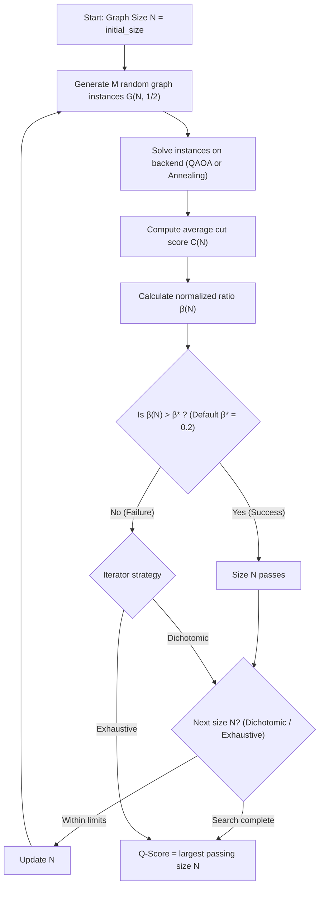
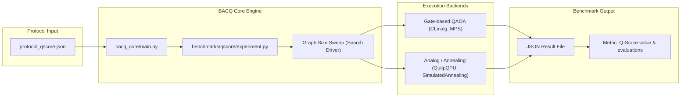

# BACQ-OP-QSCORE: Q-Score Benchmark

## 1. Overview & Concept

**Q-Score** is an application-oriented metric designed to evaluate the practical performance of quantum processors on a representative combinatorial optimization problem: **Max-Cut**.

Instead of measuring low-level physical indicators (like gate fidelities or coherence times), Q-Score assesses the end-to-end performance of a complete workflow (problem formulation, quantum algorithm, classical optimizer, and hardware/emulator constraints).

> **In short:** Q-Score is the largest problem size $N$ (number of vertices in a graph) for which a solver performs significantly better than a random assignment according to a normalized quality threshold.

---

## 2. Mathematical Definition

### Max-Cut on Random Graphs
Q-Score benchmarks performance on Erdős-Rényi random graphs $G(N, 1/2)$ with $N$ vertices, where each edge exists with probability $p = 1/2$.

For each graph size $N$, the benchmark evaluates:
1. **$C(N)$**: The average cut score achieved by the tested quantum algorithm / backend across multiple graph instances.
2. **$C_{rand}(N)$**: The baseline expected score obtained by a purely random guess:
   $$C_{rand}(N) \approx \frac{N^2}{8}$$
3. **$C_{max}(N)$**: The expected optimal cut score achievable for random graphs $G(N, 1/2)$:
   $$C_{max}(N) \approx \frac{N^2}{8} + 0.178\,N^{3/2}$$

### Normalized Quality Ratio $\beta(N)$
The normalized quality ratio measures the fraction of usable improvement over random guessing achieved by the setup:

$$\beta(N) = \frac{C(N) - C_{rand}(N)}{C_{max}(N) - C_{rand}(N)} \approx \frac{C(N) - \frac{N^2}{8}}{0.178\,N^{3/2}}$$

- $\beta(N) = 0$: Performance is no better than random guessing.
- $\beta(N) = 1$: Performance achieves the theoretical optimum.
- $0 < \beta(N) < 1$: Meaningful optimization is captured.

### The Q-Score Metric
Given a target quality threshold $\beta^*$ (by default $\beta^* = 0.2$, i.e. 20% of the available improvement above random):

$$\text{Q-score}(\beta^*) = \max \{ N \mid \beta(N) > \beta^* \}$$

---

## 3. Evaluation Workflow



---

## 4. Architecture & Supported Backends

In BACQ, Q-Score supports both gate-based variational algorithms and analog/annealing workflows:



- **QAOA (Gate-based):** Solves Max-Cut instances with parameterized circuits (depth $p$) optimized by a classical optimizer (e.g. COBYLA via `CLinalg` or `MPS`).
- **Analog / Annealing:** Solves Max-Cut with continuous time evolution:
  - `QutipQPU`: Analog Quantum Optimization (AQO) simulated via myQLM.
  - `SimulatedAnnealing`: Classical simulated annealing on MaxCut problems.

---

## 5. Installation

From the `bacq_core` repository root, install the optional `qscore` dependency:

```bash
pip install -e ".[qscore]"
```

This installs `qat-qscore` from [myQLM/qscore](https://github.com/myQLM/qscore).

---

## 6. How to Run

Run Q-Score using a BACQ protocol file:

```bash
# Run on CLinalg (QAOA)
python src/bacq_core/main.py examples/protocol_qscore.json

# Run on QutipQPU (Analog AQO)
python src/bacq_core/main.py examples/protocol_qscore_qutip.json

# Run on SimulatedAnnealing
python src/bacq_core/main.py examples/protocol_qscore_simulated_annealing.json
```

### Protocol Parameters

| Parameter | Type | Description | Default |
| :--- | :--- | :--- | :--- |
| `device` | string | Target simulator/QPU (`CLinalg`, `QutipQPU`, `SimulatedAnnealing`, `MPS`, etc.) | Required |
| `initial_size` | integer | Smallest graph size to test | `5` |
| `size_limit` | integer | Largest graph size to test | `20` |
| `beta` | float | Target quality threshold $\beta^*$ | `0.2` |
| `iterator` | string | Search strategy: `"dichotomic"` (binary search) or `"exhaustive"` | `"dichotomic"` |
| `depth` | integer | QAOA ansatz depth (QAOA devices only) | `1` |
| `seed` | integer | Random seed for graph instance generation (`null` for random) | `42` |
| `qutip_steps` | integer | Discretization steps for `QutipQPU` | `100` |
| `qutip_tmax` | float | AQO evolution time for `QutipQPU` | `5.0` |
